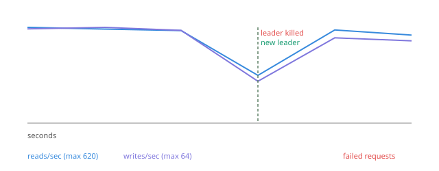
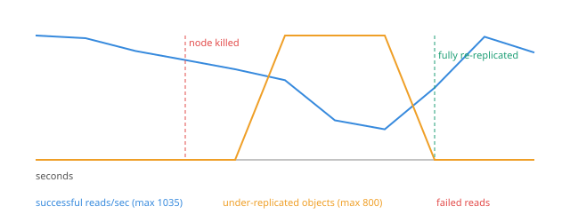

# mini-s3

A replicated object store inspired by Amazon S3, with no single point of failure:

- **Storage:** objects are spread across storage nodes with **consistent hashing**, every object is kept on **3 nodes**, and writes need a **quorum of 2**. A **repair worker** restores lost copies when a node dies.
- **Metadata:** the gateways that track where every object lives run **Raft**, a consensus algorithm. Three gateways keep identical metadata, and if the leader dies, the others elect a new one in about half a second.

A chaos test crashes a storage node or the leader gateway under live traffic and measures what clients see.

**Design doc:** [docs/DESIGN.md](docs/DESIGN.md) covers the decisions, the alternatives considered and the trade-offs.

## Results

Four storage nodes, three gateways, 1,000 objects (1–64 KB each), 16 clients reading and 4 clients writing continuously. Midway through, one process was killed with `SIGKILL`.

| Metric | Leader gateway killed | Storage node killed |
|---|---|---|
| Reads during the test | 3,673, **0 failed** | 6,671, **0 failed** |
| Writes during the test | 365, **0 failed** | 678, **0 failed** |
| Read latency p50 / p99 | 26 ms / 52 ms | 27 ms / 64 ms |
| Slowest request (waiting out the failover) | 647 ms | 328 ms |
| Recovery | new leader elected in **485 ms** | back to 3 copies of everything in **6 s** |
| Objects intact afterwards (SHA-256 verified) | **1,365 / 1,365** | **1,678 / 1,678** |

After the killed node rejoined, all three gateways held identical metadata (1,678 objects and 5,034 copies, exactly 3 each), and the files on disk matched.

**Leader gateway killed.** Reads (blue) and writes (purple) pause for about half a second while the remaining gateways elect a new leader, then carry on. Clients retried against the other gateways, so no request failed.



**Storage node killed.** Under-replicated objects (orange) spike when the gateway notices the crash, and the repair worker brings them back to 3 copies.



Measured on a MacBook Pro with all processes on one machine. Elections took 338–985 ms across runs, and every run had 0 failed requests and all objects intact. Reproduce with `./ms3 chaos --kill leader` or `./ms3 chaos --kill node`.

## Architecture

```
               client (./ms3 CLI, curl, any HTTP client) — talks to any gateway
                                     │
         ┌───────────────────────────┼───────────────────────────┐
         ▼                           ▼                           ▼
  ┌─────────────┐   Raft log  ┌─────────────┐   Raft log  ┌─────────────┐
  │ gateway g1  │◄───────────►│ gateway g2  │◄───────────►│ gateway g3  │
  │  follower   │             │   LEADER    │             │  follower   │
  │ metadata db │             │ metadata db │             │ metadata db │
  └─────────────┘             └──────┬──────┘             └─────────────┘
    followers forward requests       │ only the leader reads/writes blobs,
    to the leader                    │ checks node health and runs repair
             ┌───────────────┬───────┴───────┬───────────────┐
             ▼               ▼               ▼               ▼
          node a          node b          node c          node d
       (blobs on disk) (blobs on disk) (blobs on disk) (blobs on disk)
```

| File | Role |
|---|---|
| [`mini_s3/raft.py`](mini_s3/raft.py) | Raft: leader election, log replication, commit rules, and a leader lease for reads. |
| [`mini_s3/gateway.py`](mini_s3/gateway.py) | S3-style API, forwarding to the leader, quorum writes, read failover and read repair, health checks, the repair worker and the orphan sweeper. |
| [`mini_s3/metadata.py`](mini_s3/metadata.py) | The replicated state machine: objects, copies, pending deletes, and the Raft log, in SQLite. |
| [`mini_s3/ring.py`](mini_s3/ring.py) | Consistent hash ring with 64 virtual nodes per server. Adding a 5th node moves about 20% of keys, versus about 80% with `hash % n`. |
| [`mini_s3/node.py`](mini_s3/node.py) | Storage node. Atomic writes (temp file, `fsync`, rename) and a SHA-256 check on every write. |
| [`mini_s3/chaos.py`](mini_s3/chaos.py) | Load generator and crash test, with a client that fails over between gateways. Writes a report, a CSV and a chart to `results/`. |
| [`mini_s3/static/status.html`](mini_s3/static/status.html) | Live dashboard at `http://127.0.0.1:7480/`. It switches to another gateway if the one serving it dies. |

### How the gateways stay consistent (Raft)
- **Elections:** each gateway starts as a follower. If it hears nothing from a leader for a random 300–600 ms, it asks the others for votes. A gateway only votes for a candidate whose log is at least as complete as its own, so a new leader always has every committed change.
- **Every metadata change is a command in a replicated log,** for example "point `photos/cat.jpg` at blob X on nodes a, b and c". The leader sends new entries to the followers, and an entry is **committed** once a majority has stored it. Every gateway then applies the same commands in the same order, so their metadata stays identical.
- **No split brain:** a gateway cut off from the majority can't commit anything, so it refuses writes instead of drifting apart.
- **Correct reads:** the leader serves reads only while a majority has acknowledged it within the last 225 ms, shorter than the minimum election timeout, so no other leader can exist yet. A new leader first commits an empty entry, which guarantees its metadata includes everything committed before it took over.
- **Durability:** the log, the current term and the vote are saved in SQLite before a gateway answers, so a gateway that crashes and restarts picks up where it left off.

### How a write works
1. The client sends `PUT /bucket/key` to any gateway. Followers forward it to the leader.
2. The leader hashes `bucket/key` onto the ring and sends the bytes and their checksum to the first 3 *live* storage nodes in parallel.
3. If at least 2 confirm (the **write quorum**), the leader proposes the new metadata through Raft and returns `201` once a majority of gateways has committed it. Otherwise it returns `503`. Writes never succeed with too few copies.
4. Every write gets a new blob id, so an overwrite never modifies data in place. The old version's copies are queued for deletion.

### How a read works
Try the replicas in ring order, live nodes first, and verify the SHA-256 of whatever comes back. A dead node or a corrupt copy is skipped. A node that *answers* with a missing or corrupt copy gets the good bytes written back immediately (**read repair**).

### How failures are handled
- **A storage node dies:** the leader checks every node each second and marks one down after 2 misses in a row. Every 2 seconds the repair worker copies under-replicated objects, from a verified source, to the next live nodes on the ring.
- **A node rejoins:** objects briefly have 4 copies. Extras are removed once all 3 "home" nodes hold the data.
- **The leader gateway dies:** the followers elect a new leader. The new leader probes the storage nodes before serving, and clients retry on another gateway in the meantime (`503` responses carry an `x-ms3-retry` header).
- **A leader dies mid-write:** blobs may already be on the storage nodes even though their metadata was never committed. A sweeper on the leader deletes copies that no metadata mentions once they're 2 minutes old.
- **Deletes while a node is down:** they succeed immediately, and the blob deletion waits in a queue until the node returns.

## Run it

Needs Python 3.10+. Everything runs locally and costs nothing.

```bash
python3 -m venv .venv && .venv/bin/pip install -r requirements-dev.txt
./ms3 cluster up                     # 4 storage nodes + 3 gateways; dashboard at http://127.0.0.1:7480/
./ms3 put README.md docs/readme.md   # upload a file
./ms3 get docs/readme.md             # download it
./ms3 ls docs
./ms3 status                         # gateways (leader/follower) and storage nodes
./ms3 cluster kill b                 # crash a storage node
./ms3 cluster kill leader            # crash the leader gateway; watch a new one get elected
./ms3 cluster start b                # bring things back (use a node letter or gateway id like g2)
./ms3 chaos --kill leader            # crash test: leader gateway
./ms3 chaos --kill node              # crash test: storage node
./ms3 cluster down
.venv/bin/python -m pytest -q        # 26 tests, including real multi-process failure scenarios
```

Any HTTP client works too: `curl -T photo.jpg http://127.0.0.1:7480/photos/cat.jpg`, then `curl http://127.0.0.1:7481/photos/cat.jpg -o cat.jpg` (any gateway gives the same answer).

Gateways use ports 7480–7482. If those are taken, run `MS3_PORT=7580 ./ms3 cluster up` and use the same `MS3_PORT` for every `./ms3` command.

## Bugs the chaos tests found

Each of these passed the basic tests and only showed up when something was killed under load.

1. **The throughput bottleneck was the HTTP client, not the server.** Uploads ran at 48/s. Profiling showed the gateway served about 1,250 trivial requests per second, but httpx's async connection pool stalled at high concurrency. Switching the internal client to aiohttp gave **10× faster uploads (48 → 508/s) and 7× faster reads (184 → 1,263/s)**.
2. **Reads in the second after a crash orphaned data.** Before the health checker noticed the crash, reads got "connection refused" and treated it as "this copy is corrupt", so the gateway stopped tracking 106 perfectly good copies. The fix separates "node unreachable" from "copy bad", and any copy that stops being tracked is queued for deletion.
3. **A race made a healthy node look dead.** The health endpoint counted files while the repair worker was deleting them, crashed with `FileNotFoundError`, and the node "flapped" down. The fix tolerates the race and requires 2 misses in a row before declaring a node dead.
4. **The repair metric hid the damage.** Under-replicated counts were published only after each repair pass finished, so the dashboard always showed 0. They're now published before copying starts.
5. **Cleanup slowed down healing.** When a test overwrote 1,000 existing objects, the 1,000 old versions were deleted one at a time inside the repair pass, and healing took **37 s**. Running deletes in parallel brought it down to **6 s**.
6. **A new leader briefly thought every storage node was dead.** It marked its health check "done" when the check *started*, so a write arriving in those milliseconds saw 0 nodes up and was refused. That was the likely cause of the 1 failed write in the first leader-crash test; the next 6 leader-crash runs had none. The check is now marked done when it finishes, and concurrent requests wait for that one probe.
7. **A late repair copy leaked storage forever.** If an object was overwritten while the repair worker was copying its old version, recording the finished copy put the old version back under tracking, so it was never deleted (18 copies after one test). Now a copy of a version that's no longer current goes straight to the deletion queue, and the repair pass sweeps up any stray records.
8. **A bucket named `docs` was unreachable.** FastAPI's built-in API documentation lives at `/docs`, so listing that bucket returned a web page. The built-in pages are turned off.

## Limitations and next steps

- **No log compaction.** The Raft log grows forever, and a brand-new gateway replays it from the beginning. Next step: periodic snapshots of the metadata database.
- **Fixed membership.** The set of gateways is set at startup. Adding or removing one safely needs Raft's joint-consensus membership changes.
- **A retried write may happen twice.** If a leader dies after committing a write but before answering, the client retries and the object is written again. That's harmless for whole-object puts, but a real system would add idempotency keys.
- **Stats reset on failover.** Counters such as "repairs done" live in the leader's memory.
- **Objects are held in memory** while passing through the gateway (64 MB limit). Next step: streaming plus multipart upload.
- **No background scrubbing.** Corruption is only found when an object is read.
- **Deploying to real machines:** run each node and gateway on its own EC2 instance (Free Tier) and point `NODES` and `PEERS` at them. Set an AWS budget alarm first.
